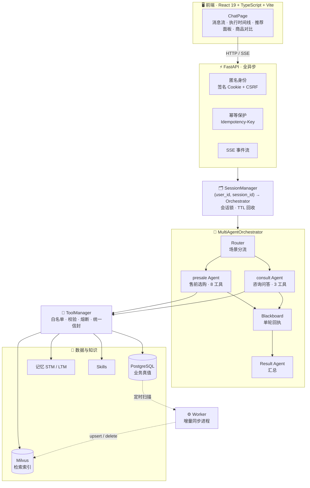
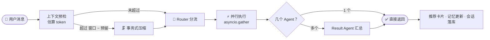
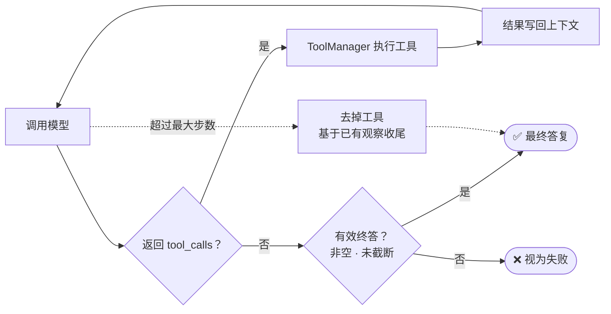
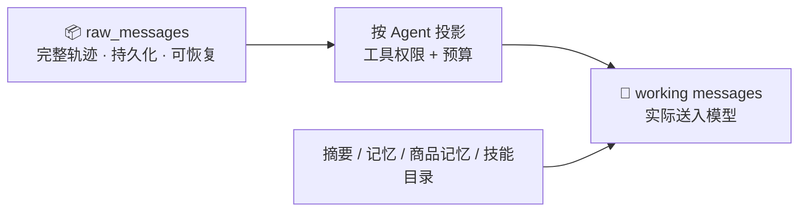
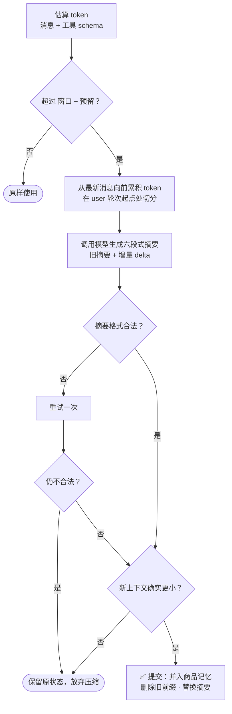
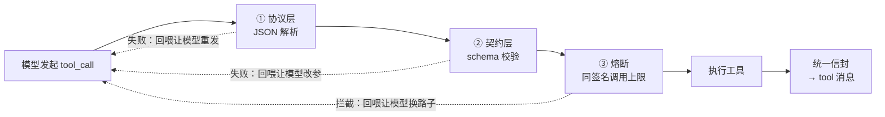
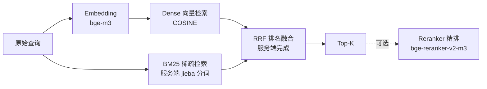
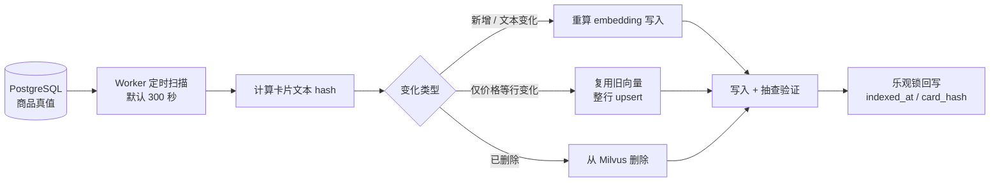

<div align="center">
  

  <h1>🛒 PickWise · 智能 3C 选购决策助手</h1>
  <p><strong>多 Agent 编排 · 手写 ReAct · 混合检索 · 上下文工程 · 多租户隔离</strong></p>
  <p>不依赖 LangChain / LangGraph —— 从会话管理到工具调用，每一层都自己实现</p>

  <p>
    
    
    
    
    
    
  </p>

  <p>
    <a href="#-核心亮点">核心亮点</a> ·
    <a href="#-系统架构">系统架构</a> ·
    <a href="#-多-agent-编排">多 Agent 编排</a> ·
    <a href="#-上下文工程">上下文工程</a> ·
    <a href="#-工具系统">工具系统</a> ·
    <a href="#-检索与知识">检索与知识</a> ·
    <a href="#-快速开始">快速开始</a>
  </p>
</div>

<!--
  TODO：建议在此放 1~2 张截图（聊天界面 + 执行时间线 + 推荐面板），例如：
  <p align="center"></p>
-->

---

## 🎯 项目简介

**PickWise** 是一个面向 3C 商品（笔记本 / 手机 / 耳机）选购的智能决策助手。用户用自然语言描述预算、用途和偏好，系统会理解需求、筛选商品、查询选购知识、对比候选款，并给出有依据的推荐。

它的重点不是「调用一次大模型」，而是把下面这些东西组织成一个**完整、可运行、可评测的 Agent 应用**：

> 用户会话 · 多 Agent 协作 · 工具调用 · 商品检索 · 知识库检索 · 用户记忆 · 上下文压缩 · SSE 过程展示 · 幂等与用户隔离

## ✨ 核心亮点

| | 亮点 | 一句话说明 |
|:--:|---|---|
| 🧩 | **历史工具调用投影** | 多 Agent 共享历史时，把「别人的工具调用」折叠成语义中性的描述——Agent 读得懂上下文，却不会照抄去调自己没有的工具 |
| 🗜️ | **事务式上下文压缩** | 先生成摘要、确认上下文真的变小，才删除旧消息；任一步失败都零副作用 |
| 🛡️ | **工具三道闸门** | 协议解析 → schema 校验（归一化 / 夹紧 / 拒绝）→ 重复调用熔断；失败以统一信封回喂模型，而不是抛异常 |
| 🔎 | **混合检索** | Dense 向量 + BM25 关键词 + RRF 融合，商品库与知识库分库；硬条件以 PostgreSQL 真值下推，不信索引里的旧数据 |
| 🔄 | **商品索引增量同步** | 卡片文本 hash 判断变化，只有文本变了才重算向量；乐观锁 + 状态最后提交，天然幂等 |
| 🔐 | **多租户隔离 + 幂等** | 签名 Cookie + CSRF、`(user_id, session_id)` 会话键、商品 `ref` 作用域绑定、`Idempotency-Key` 防重复执行 |
| 📡 | **SSE 过程可视化** | 需求理解 → 商品筛选 → 知识查询 → 生成建议，每一步实时可见；浏览器断连不会丢失已生成的结果 |
| 🧪 | **可复现评测** | 231 条用例，规则断言决定通过与否，LLM-as-judge 只做参考；沙箱隔离、判分器自检 |

## 🏗️ 系统架构



**核心原则：PostgreSQL 是业务真值，Milvus 只是检索索引；会话是并发与隔离的边界；Agent 的能力由工具白名单硬隔离。**

### 一次请求的生命周期



## 🧠 多 Agent 编排

> 📍 `app/multi_agent/` — `orchestrator.py` · `router.py` · `agents.py` · `blackboard.py` · `context_pack.py`

### Router：把问题分给合适的 Agent

| 用户问题 | 路由结果 |
|---|---|
| 「6000 元买轻薄本」 | `[presale]` |
| 「OLED 和 LCD 有什么区别」 | `[consult]` |
| 「推荐一台适合办公的电脑，并解释屏幕怎么选」 | `[presale, consult]` → 并行执行后汇总 |

- **输出契约**：小写化 → 去重 → 合法性过滤 → 固定顺序 → 空结果兜底为 `consult`，保证下游拿到的永远是有序、合法、非空的场景列表
- **轻量分类调用**：`temperature=0`、固定低思考强度（`reasoning_effort=low`），只读「最近 4 条消息（每条 ≤ 300 字）+ 历史摘要 + 当前输入」
- **前缀缓存友好**：固定不变的 `ROUTER_PROMPT` 放在最前，动态内容全部排在后面，让服务端 KV Cache 能命中
- **瞬时故障降级**：模型限流 / 超时等瞬时错误时回退默认场景，并明确记录为「降级」，而不是当成无损成功

### SubAgent：手写 ReAct 循环



- **每个 Agent 独立配置**：system prompt、工具白名单、最大步数（默认 10）、上下文预算、工具结果截断策略
- **HTTP 200 ≠ 任务完成**：回复为空、`finish_reason=length`、或仍携带 `tool_calls`，一律视为「未返回有效终答」，不会把半截内容交给用户
- **并行安全（Copy-on-Write）**：每个 Agent 只操作自己的 working 副本，执行期间 `raw_messages` 一个字不变；合并由主线程按固定顺序单点完成

| Agent | 职责 | 工具白名单 |
|---|---|---|
| 🛍️ `presale` | 售前选购：理解预算 / 用途，筛选、对比、推荐 | `search_catalog` `search_products` `get_detail` `compare_products` `get_user_favorites` `retrieve_knowledge` `load_skill` `recall_user_memory` |
| 💬 `consult` | 咨询问答：参数科普、售后政策、FAQ | `retrieve_knowledge` `get_detail` `load_skill` |

### Blackboard：只写不互读

- Agent 之间**不互相读取**，互不等待，可以真正并行
- 只有 Result Agent 读取全部回执；黑板只服务当前一轮，**不跨轮持久化**
- 只有 1 个 Agent 时直接返回；多个 Agent 才汇总——单 / 多 Agent 是同一条执行路径的两种特例
- **部分失败 ≠ 整体失败**：失败记录写入黑板，Result Agent 如实说明哪部分没完成；Result Agent 自己不调工具，避免编造

## 🧩 上下文工程

> 📍 `app/agent/context_budget.py` · `compaction.py` · `product_tracker.py` · `app/multi_agent/context_pack.py`

这是项目里最值得细看的部分。核心思路：**存档轨道**（`raw_messages`，完整可恢复）与**工作轨道**（按 Agent 权限和预算生成的 working messages）分离。



### 1️⃣ 历史工具调用投影

**问题**：两个 Agent 共享同一份会话历史，里面包含对方的 `tool_calls`。模型看到「邻居调过某个工具」，会模仿去调；但执行层的白名单必然拒收，白白浪费一轮 LLM 调用。

**做法**：构建每个 Agent 的 working messages 时，按**完整调用块**（一条 `assistant(tool_calls)` + 其后连续的 `tool` 消息）判定——块内工具**全部越权**，就整块折叠成一句中性描述；只要含有共享工具，整块原样保留。

```text
折叠前（consult 视角）                          折叠后
assistant: tool_calls = [search_products(…)]   assistant: （上一轮完成了商品与知识检索，
tool:      {"results": [ …长长的商品 JSON… ]}              具体工具与结果已略。）
```

- **保留语义，不留符号**：Agent 仍能读懂「上一轮发生过什么」，但看不到工具名和参数，没有可模仿的对象
- **文案按语义类别生成**（检索 / 查询 / 对比 / 用户偏好 / 流程加载），而不是一句笼统的「已检索」。文案失真比泄漏工具名代价更大：把「读取用户收藏」说成「做过检索」，下一轮可能跳过 `recall_user_memory` 直接编造偏好
- **必须整块折叠**：OpenAI 协议要求 `tool_calls` 与 `tool` 消息成对出现，拆开会让 API 直接报错
- 投影只作用于入站视图，**不改动 `raw_messages` 这份事实**
- 已知取舍：同一次响应里混调越权工具与共享工具时整块保留。该组合在当前白名单结构下结构性罕见，按调用粒度拆分反而会让轨迹失真

### 2️⃣ 事务式上下文压缩

压缩被设计成一个**事务**：先计算、后提交。



| 设计点 | 说明 |
|---|---|
| **切点只落在 user 消息** | 天然不会拆开 `user → assistant(tool_calls) → tool → assistant` 调用链；按 token 从后往前累积（保护「最近」而不是「找得到哪能切」），当前尚未完成的 turn 永远不进摘要。切点思路参考 pi agent，并做了简化 |
| **保守的 token 估算** | 中文约 1.5 token、ASCII 约 3 字符 / token，宁多不少；同时估算 tool schema，并取「所有 Agent × 单 / 多模式」中最大的一个作基准；真实 `prompt_tokens` 另行记录用于校准 |
| **六段式结构化摘要** | 用户目标 / 约束与偏好 / 进展 / 关键决策 / 下一步 / 关键上下文；固定标题校验，缺段、乱序、空段都判失败 |
| **增量摘要** | 只基于「旧摘要 + 本段 delta」生成，不全量重述 |
| **摘要撞墙补救** | 增量摘要只增不减，越限就再也压不动——所以越限时让模型把摘要自己再压缩到上限的 2/3，宁可丢叙述细节，也不让压缩整体失效 |
| **先摘要后删除** | 摘要失败、格式不对、没有缩小上下文，原始历史都不会被破坏 |

**参数**（`.env`）：

| 变量 | 默认值 | 含义 |
|---|---|---|
| `CONTEXT_WINDOW` | 200000 | 策略阈值（不是模型真实窗口），提前压缩以控制成本与延迟 |
| `RESERVE_TOKENS` | 32768 | 为回复预留的空间，同时是生成调用的 `max_tokens`；触发线 = `CONTEXT_WINDOW − RESERVE_TOKENS` |
| `KEEP_RECENT_TOKENS` | 8000 | 压缩后保留的最近上下文 |

> 💡 导购对话通常远小于 30K token，默认值下几乎不会触发压缩。想观察压缩行为时，可以调小为 `CONTEXT_WINDOW=40000`、`RESERVE_TOKENS=16384`、`KEEP_RECENT_TOKENS=8000`。

### 3️⃣ 工具结果截断

工具结果超长时，给模型看的是**带头尾的 JSON 预览**，并明确标注 `original_chars / shown_chars / omitted_chars`，要求「不可推断省略部分」。预算分配头尾各 7/16、余下 1/8 留给 JSON 骨架与转义膨胀，硬约束 `len(view) <= max_chars`。

> 入库即截断：存下来的就是模型看到的，不再「全量入账 + 发送前另做一份视图」，两者也就不会漂移。

### 4️⃣ 商品记忆：不依赖文本摘要

`product_tracker.py` 独立保存对话中出现过的商品（`product_id` / `name` / `price_at_mention`）：

- **事实源唯一**：名称和价格只从**工具返回的 JSON** 提取，不让 LLM 参与，不会被模型「顺手改写」
- 压缩时在同一事务内先并入商品记忆、再删除原文，所以压缩之后依然能回答「上次推荐的那款」
- 字段名显式叫 `price_at_mention`，并在 prompt 中声明是历史价，防止下一轮把旧价当现价报给用户

## 🔧 工具系统

> 📍 `app/agent/tools/` — `registry.py` · `manager.py` · `validation.py` · `result.py`

| 工具 | 作用 | presale | consult |
|---|---|:--:|:--:|
| `search_catalog` | PostgreSQL 结构化筛选（预算 / 品类 / 品牌 / 参数） | ✅ | |
| `search_products` | 商品语义检索（Milvus 混合检索 + PG 回查真值） | ✅ | |
| `get_detail` | 商品详情 | ✅ | ✅ |
| `compare_products` | 多款商品对比 | ✅ | |
| `retrieve_knowledge` | 选购指南 / FAQ / 配送 / 售后知识 | ✅ | ✅ |
| `get_user_favorites` | 当前用户的收藏 | ✅ | |
| `recall_user_memory` | 主动读取用户画像 | ✅ | |
| `load_skill` | 按需加载技能流程 | ✅ | ✅ |

### schema 是契约的单一事实来源

同一份 `TOOL_DEFINITIONS` 既作为 Function Calling 的说明书发给模型，又被**反向读取**来做执行前的参数校验——不存在「说明书改了、校验忘改」。

### 三道闸门



- **① 协议层**：刻意**不修补**坏 JSON——截断若发生在值的中间，补出来的是错参数且完全静默
- **② 契约层**：按「错误有没有消解歧义」分三类处置

  | 处置 | 例子 |
  |---|---|
  | 无损归一化（静默） | `"10"` → `10`；可选参数传 `null` 视为未提供 |
  | 边界夹紧（并告知） | `limit` 超上限取上限；数组超长取前 N 项，信息记入 `notice` |
  | 语义拒绝 | 枚举越界、必填缺失、数组不足下限 |

- **③ 熔断**：同一签名（工具名 + **归一化后**的参数）在一轮内第 3 次调用会被拦下；签名建立在归一化之后，所以把 `"10"` 改写成 `10` 绕不过去。计数生命周期 = 一次 ReAct 循环，不会误伤用户下一轮的重复提问

### 统一信封：失败是输入，不是异常

```json
{ "success": false, "error": "没有符合条件的商品，请调整预算或条件", "data": {} }
```

所有工具返回同一结构。对模型来说失败是「可以据此继续决策的业务输入」（换条件 / 如实告知用户），`error` 只放人话、不拼异常细节。

## 🔍 检索与知识

> 📍 `app/agent/rag/` · `app/agent/tools/search_products.py` · `app/services/product_sync.py` · `app/worker.py`

### 混合检索：Dense + BM25 + RRF



- **Dense** 负责语义相近的问法；**BM25** 负责型号、品牌、专有名词的词面精确匹配；**RRF** 按排名融合，不受两路分数量纲不同的影响
- **索引模型校验**：Embedding 模型名随 collection 持久化，加载时与当前 Embedder 比对，不一致直接报错，避免「换了模型却还在用旧索引」
- **Reranker 为可选的二阶段精排**，默认关闭
- **两个 collection**：`ecom_kb`（知识库，按二级标题切块，更新频率低）与 `product_kb`（商品语义库，一商品一条，随目录变化），语义域和更新节奏都不同

### 商品检索：Milvus 只管召回，真值回查 PostgreSQL

`search_products` 的两个关键设计：

1. **硬条件用 PG 真值下推**：品类 / 价格不再用 Milvus 标量过滤（索引里的旧价会漏召回或误杀），而是先按 PG 当前数据算出符合条件的 ID 集合，再下推 `product_id in [...]`。表达式只用仓储返回的 ID 构造，不拼接任何用户原文
2. **命中后批量回查 PG**：价格永远是最新的，不依赖进程内快照

### 商品索引增量同步



- **单 hash 设计**：`card_hash` 只回答「向量要不要重算」；价格、品类等行数据永远取 PG 整行 upsert，没有「哪个字段变了」的分支。卡片文本**不含价格**，改价不会触发重算 embedding
- **幂等三支柱**：① `product_id` 即 Milvus 主键，upsert / delete 天然幂等；② **状态最后提交**——Milvus 写完并抽查通过，才回写 PG 的索引状态，中途失败下一轮自然重做；③ **乐观锁**——标记带 `WHERE updated_at = 快照值`，同步期间又被改过的行不会被标成「已索引」
- **契约指纹**：Embedding 模型 + 卡片模板版本参与校验，不一致拒绝增量同步，提示全量重建
- **Worker 是独立进程**：「跑完再计时」避免慢轮次堆积重入；单轮失败退避重试而不退出；SIGTERM 优雅退出

```bash
python -m app.worker                                            # 常驻增量同步
python app/scripts/build_product_kb.py --mode incremental --dry-run   # 只看差异计划
python app/scripts/build_product_kb.py --mode rebuild                 # 全量重建
```

## 🔐 多租户与会话隔离

> 📍 `app/api/auth.py` · `app/services/session_manager.py` · `app/services/idempotency.py` · `app/services/product_refs.py`

| 层面 | 实现 |
|---|---|
| 🪪 **匿名身份** | 服务端用 `itsdangerous` 签名的 Cookie（用户 UUID + CSRF 随机值），不手写加解密；Cookie 被篡改或过期返回 401，**不会静默签发新身份** |
| 🛑 **CSRF** | 写请求必须携带与凭证内一致的 `X-Pickwise-CSRF`（`compare_digest` 安全比对），并校验 `Origin` 白名单 |
| 🗂️ **会话键** | `(user_id, session_id)` 是会话的唯一键；落库表主键同为该组合，跨用户无法读取 |
| 🏷️ **商品 `ref`** | 前端只拿到随机 `ref` 和展示编号（#01 / #02），**看不到内部 `product_id`**；ref 绑定 `user_id + session_id`，别的用户 / 会话拿到也无法使用，1 小时 TTL |
| 🔁 **请求幂等** | `Idempotency-Key` + 请求 hash，判定为 `execute / replay / in_progress / conflict` 四种结果之一，客户端重试不会让 Agent 重复执行；账本写失败也不会重跑已完成的 Agent，而是标注 `X-Idempotency-Persisted: false` |
| 🔒 **会话并发** | 同一会话同时只允许一个请求在跑，后到的直接返回 `SESSION_BUSY`；不同会话完全并行 |
| ♻️ **资源回收** | 空闲 Agent 按 TTL（默认 30 分钟）回收，上限 100 个活跃会话；持久化失败的会话暂不回收，避免丢内存里的最新数据；服务退出时排空并逐会话保存 |

## 📡 流式体验与前端

> 📍 `frontend-react/src/` · `app/api/routes.py` · `app/services/chat_events.py`

**SSE 事件**（`POST /api/chat/stream`）：

```text
event: status          {"stage":"routing","state":"running","title":"理解需求", ...}
event: status          {"stage":"routing","state":"done"}
event: tool.started    {"agent":"presale","tool":"search_catalog","tool_title":"按预算和条件筛选商品", ...}
event: tool.finished   {"agent":"presale","summary":"找到 8 款商品","count":8, ...}
event: recommendations {"products":[ …卡片（无内部 product_id）… ]}
event: answer.delta    {"text":"根据你的预算……","seq":0}
event: done            {"reply":"…","failed":false,"replayed":false}
```

- **过程事件是实时的**：路由、每次工具调用的开始 / 结束都在执行过程中推出，前端据此渲染「理解需求 → 筛选商品 → 查询资料 → 生成建议 → 保存会话」时间线
- **断连不丢结果**：执行放在独立任务里，浏览器断开只停止传输，生成、保存、幂等记账照常完成；用相同 `Idempotency-Key` 重试会直接回放结果
- **不拖慢 Agent**：事件队列有界，队列满时丢弃最旧的展示事件；15 秒心跳保活
- **推荐面板与正文严格一致**：只展示回答里「真正陈列」的商品（表格行 / 标题 / 列表项算陈列，顺口罗列不算），卡片价格以正文所写为准，没写才回退目录价

> ⚠️ 诚实说明：`answer.delta` 是 Agent **生成完整答案之后**按句切分回放，不是模型的 token 级流式。当前解决的是「过程展示」，不是首字延迟。

**前端**：React 19 + TypeScript + Vite，`useReducer` 管理页面状态（当前规模无需 Redux）；手写 SSE 解析（支持心跳注释、断流检测）；商品详情抽屉、最多 3 款商品对比、会话列表与中断请求。

## 💭 记忆与技能

> 📍 `app/agent/memory/` · `app/agent/skills/`

**记忆系统**

| | 短期记忆 STM | 长期记忆 LTM |
|---|---|---|
| 范围 | 当前会话 | 跨会话，按用户 |
| 内容 | 预算、用途、偏好、排斥条件、近期事实 | 用户画像槽位：`constraint` 约束 / `reject` 排斥 / `scene` 场景 / `weight` 权重 |
| 更新 | 每轮成功后由模型从最近消息提取 | 会话结束时巩固，原子写入 |
| 使用 | 注入 system prompt | Agent 通过 `recall_user_memory` **按需读取** |

> 会话**首轮不注入**长期记忆：新会话一上来就带着上个会话的预算和场景，模型会误以为「你已经说过」而跳过澄清（实测问题）。需要历史偏好时由 Agent 自己调用 `recall_user_memory`。记忆提取失败不会覆盖已经生成的答案。

**Skills 技能系统**

技能是 `SKILL.md`（YAML frontmatter + Markdown 指令），遵循 Agent Skills 的渐进式披露：启动时只把每个技能的 `name + description`（约 100 token）放进 prompt，Agent 判断需要时再调用 `load_skill` 加载完整流程；frontmatter 中的 `agents` 字段控制技能对哪个 Agent 可见。内置 `product-recommend` · `process-return` · `policy-check` · `track-order` 四个技能。

## 🗄️ 数据层

> 📍 `app/db/`

```text
PostgreSQL  =  业务真值   商品 · 规格 · 价格 · 收藏 · 会话快照 · 幂等记录
Milvus      =  检索索引   只负责召回，价格 / 详情一律回查 PG
```

| 表 | 内容 |
|---|---|
| `products` | 商品目录、规格、介绍、价格，附带 `card_hash` / `indexed_at` 索引状态 |
| `favorites` · `user_favorites` | 用户收藏 |
| `sessions` | 会话快照（`messages` / `summary` / `short_term_memory` / `products` / `recommendations` 为 JSONB），带 `version` 与 `status` |
| `chat_idempotency_records` | 幂等账本（主键 `user_id + session_id + idempotency_key`，带过期时间） |

- 内置 100 款种子商品（笔记本 34 / 手机 33 / 耳机 33），仅用于冷启动与灾备，运行时一律以 PG 为准
- 使用 `psycopg` 异步连接池；Web 模式走 PostgreSQL，CLI 模式走本地 JSON 会话文件

## 🧪 评测与测试

> 📍 `app/evaluation/` · `app/scripts/run_*_eval.py` · `tests/`

> **规则断言决定通过与否，LLM-as-judge 只提供参考。**

| 数据集 | 数量 | 覆盖 |
|---|---:|---|
| `cases.json` | 20 | 端到端流程，含多轮指代消解 |
| `router_cases.json` | 55 | 场景路由 |
| `rag_cases.json` | 152 | 检索质量（Hit@K / MRR / Recall@K） |
| `cases_isolation.json` | 4 | 跨 Agent 工具名泄漏探针（验证历史投影是否生效） |
| **合计** | **231** | |

```bash
python app/scripts/run_eval.py                 # 端到端评测
python app/scripts/run_eval.py --self-test     # 判分器自检
python app/scripts/run_router_eval.py          # Router 专项
python app/scripts/run_rag_eval.py --top-k 5   # RAG 检索评测
```

- **沙箱隔离**：每条用例独立临时会话，关闭记忆读写，避免历史长期记忆污染评分
- **判分器自己也要被测**：自检用例构造含伪造 ID / 伪造价格的回复轨迹，验证判分器能否拒绝
- **量化幻觉防御**：检查回复里的商品 ID 是否来自真实目录、价格是否存在于目录
- **LLM judge 防抖**：`temperature=0` + 带版本号的 rubric + 强制 JSON 输出，解析失败重试一次，再失败标「未判」，宁可不判也不打假分
- **自动化测试**（`pytest tests/ -v`）覆盖 API 与认证、CSRF 与用户隔离、SSE、会话管理、幂等、工具校验与熔断、上下文预算 / 投影 / 压缩、多 Agent、商品同步、异常恢复等；核心用例注入假 client / `httpx.MockTransport` 离线运行，`verify_*.py` 是需要真实服务的手动端到端验证脚本

## ⚖️ 设计取舍

**为什么这么做 · 没做什么 · 为什么不做**

| 模块 | 当前做法 | 为什么 | 没做 / 代价 |
|---|---|---|---|
| 会话并发 | 同一会话忙时直接拒绝（`SESSION_BUSY`） | 实现简单，天然避免并发修改同一份历史 | 没做排队。要支持可用「队列 + 锁」的生产者—消费者模型 |
| SessionManager | 进程内存缓存活跃 Agent | 复用 Agent，低延迟 | 多进程部署需要分布式锁（如 Redis）或会话路由 |
| 会话持久化 | PostgreSQL JSONB 整行快照 | 实现简单、恢复方便 | 会话很长时整行读写会变重，后续可拆消息表 / 增量存储 |
| SSE | 完整答案切分后回放 | 目标是过程展示 | 不是 token 流式；降低首字延迟需要改造 LLM 调用层 |
| Router | 只看最近 4 条 + 摘要 | 只做分流、只有两个 Agent，信息足够 | 没把商品记忆喂给 Router 做指代消解——它交给下游 Agent 使用 |
| Agent 数量 | 两个（售前 / 咨询） | 业务天然分成这两类，且确有「同时需要」的场景 | 业务扩展后再增加 Agent，让协作更充分 |
| Result Agent | 不调用工具 | 角色单一、上下文可控、避免循环 | 汇总时信息不足只能如实说明 |
| 黑板 | 只写不互读 | 并行简单、无死锁、延迟低 | 跨 Agent 的冲突只能靠 Result Agent 调解 |
| 工具结果截断 | 超限保留头尾预览 | 防御性设计：防模型传参异常导致结果过大 | 检索工具本身已限制返回数，实际很少触发；也可再加固定的 max count |
| 身份认证 | 匿名签名 Cookie | 目的是跑通并验证多租户隔离 | 生产环境可换成账号体系（如 JWT） |
| MCP | 仅保留客户端与转换器，未接入 | 当前工具均为本地实现 | `ToolManager` 启用 MCP 时降级为本地工具；不要把 MCP 当作已完成能力 |

## 🚀 快速开始

### 环境要求

- Python 3.x、Node.js（建议最新 LTS）
- 一个 OpenAI 兼容协议的 LLM API Key（默认配置为 DeepSeek）
- 一个 Embedding 服务（默认 `BAAI/bge-m3`；DeepSeek 官方不提供 Embedding 接口，示例使用 SiliconFlow）
- PostgreSQL 与 Milvus Standalone

### 1. 启动基础设施

仓库不附带 compose 文件，请自行启动 PostgreSQL（默认连接 `localhost:15432`）和 Milvus Standalone（默认 `http://localhost:19530`，部署方式见 [Milvus 官方文档](https://milvus.io/docs)）：

```bash
docker run -d --name pickwise-pg \
  -e POSTGRES_USER=pickwise -e POSTGRES_PASSWORD=pickwise -e POSTGRES_DB=pickwise \
  -p 15432:5432 postgres:16
```

### 2. 安装依赖并配置

```bash
git clone https://github.com/YW216/pickwise-agent.git
cd pickwise-agent

python -m venv .venv
source .venv/bin/activate        # Windows PowerShell: .venv\Scripts\Activate.ps1

pip install -r requirements.txt
pip install langfuse             # 编排器会 import，当前 requirements.txt 未声明（追踪功能本身可不配置）

cp .env.example .env
```

编辑 `.env`，至少填写：

```ini
OPENAI_API_KEY=sk-你的模型服务密钥

# Embedding（DeepSeek 不提供，需单独配置）
EMBEDDING_BASE_URL=https://api.siliconflow.cn/v1
EMBEDDING_API_KEY=sk-你的Embedding服务密钥

# Web 服务必填：匿名 Cookie 签名密钥，至少 32 字节
# 生成：python -c "import secrets; print(secrets.token_urlsafe(48))"
AUTH_SECRET_KEY=替换为随机字符串
```

> `DATABASE_URL`、`MILVUS_URI` 等其余配置均有默认值，完整列表见 `.env.example` 与 `app/config/settings.py`。

### 3. 初始化数据

```bash
python app/scripts/init_pg.py                           # 建表 + 播种 100 款商品
python app/scripts/build_kb_index.py                    # 构建知识库索引（ecom_kb）
python app/scripts/build_product_kb.py --mode rebuild   # 构建商品语义索引（product_kb）
```

### 4. 启动

```bash
# 后端（http://127.0.0.1:8000）
python run.py

# 另开终端：商品索引增量同步 worker
python -m app.worker

# 前端
cd frontend-react
npm install
npm run build     # 构建后由 FastAPI 在 / 托管，直接访问 http://127.0.0.1:8000
# 或开发模式：npm run dev   → http://localhost:5173（/api 自动代理到 8000）
```

只想体验 Agent 本身？也可以用命令行模式：

```bash
python main.py    # 支持 skills / memory / reset / quit
```

## 📁 项目结构

<details>
<summary>点击展开目录树</summary>

```text
pickwise-agent/
├── main.py                          # CLI 入口（本地 JSON 会话）
├── run.py                           # Web 入口（Uvicorn）
├── app/
│   ├── api/                         # FastAPI：app / routes / auth / deps / schemas / envelope
│   ├── services/                    # 会话与业务服务
│   │   ├── session_manager.py       #   (user_id, session_id) → Orchestrator，会话锁与 TTL
│   │   ├── session_service.py       #   应用服务层，屏蔽具体存储
│   │   ├── idempotency.py           #   聊天幂等
│   │   ├── product_refs.py          #   商品 ref 作用域绑定
│   │   ├── recommendations.py       #   推荐卡片构建
│   │   └── product_sync.py          #   PG → Milvus 增量同步核心
│   ├── multi_agent/                 # 编排层
│   │   ├── orchestrator.py          #   统一编排入口
│   │   ├── router.py                #   场景分流
│   │   ├── agents.py                #   SubAgent（手写 ReAct）
│   │   ├── blackboard.py            #   单轮回执
│   │   └── context_pack.py          #   上下文打包与历史工具调用投影
│   ├── agent/                       # 能力层
│   │   ├── compaction.py            #   事务式压缩
│   │   ├── context_budget.py        #   token 估算 / 异常分类 / 工具结果预览
│   │   ├── product_tracker.py       #   商品记忆
│   │   ├── tools/                   #   registry · manager · validation · 业务工具
│   │   ├── rag/                     #   chunker · embedder · Milvus 后端 · retriever · reranker
│   │   ├── memory/                  #   短期 / 长期记忆
│   │   └── skills/                  #   SKILL.md 技能
│   ├── db/                          # PostgreSQL：商品 / 会话 / 用户状态 / 种子数据
│   ├── evaluation/                  # 沙箱 · 指标 · 判分 · 报告 · 评测数据集
│   ├── prompts/                     # Router / 子 Agent / Result / 记忆 / 摘要 prompt
│   ├── scripts/                     # 初始化、建索引、评测入口
│   ├── mcp_client/                  # MCP 客户端（预留）
│   ├── config/settings.py           # pydantic-settings 配置
│   └── worker.py                    # 增量同步 worker
├── frontend-react/src/              # api · components · pages · store · types
├── mcp_server/                      # MCP 服务端（暂停使用）
├── assets/                          # 横幅与商品图片
└── tests/                           # 自动化测试与验证脚本
```

</details>

## 🔌 API 一览

<details>
<summary>点击展开接口列表</summary>

所有接口使用统一响应信封（`success` / `data` / `error` / `request_id`）。

| 分类 | 接口 |
|---|---|
| 身份 | `POST /api/auth/anonymous` |
| 会话 | `POST /api/sessions` · `GET /api/sessions` · `GET /api/sessions/{id}` · `GET /api/sessions/{id}/messages` · `DELETE /api/sessions/{id}` |
| 聊天 | `POST /api/chat` · `POST /api/chat/stream`（SSE，前端主要使用） |
| 商品 | `GET /api/products/search` · `GET /api/products/{product_id}` · `GET /api/products/ref/{product_ref}` · `POST /api/products/compare` |
| 收藏 | `GET /api/favorites` |
| 健康 | `GET /api/health`（进程存活）· `GET /api/ready`（检查 PostgreSQL / Milvus） |

</details>

## 🚧 已知边界与规划

- **SessionManager 是单进程内存结构**：多进程部署需要 Redis 分布式锁或会话路由，否则同一会话可能被多个进程同时处理
- **会话是 JSONB 快照**：简单可靠，但长会话整行读写会变重，后续可考虑消息表 / 增量存储
- **SSE 不是 token 级流式**：若要降低首字延迟，需要改造 LLM 调用层
- **长期记忆目前落在本地 JSON 文件**，多实例部署时无法共享
- **MCP 尚未真正接入**：运行路径是 `Agent → 本地 ToolManager → 本地工具`
- **商品图目前以品类图为主**：`product_images.py` 已支持按商品 ID 匹配专属图
- **身份认证只是匿名模式**，用于验证多租户隔离

**Roadmap**

- [ ] 多进程会话路由 / Redis 分布式锁
- [ ] 同会话请求排队（队列 + 锁）
- [ ] LLM 调用层改造，支持真正的 token 级流式
- [ ] 账号体系（JWT）替换匿名身份
- [ ] 长期记忆持久化到数据库
- [ ] 补齐 `requirements.txt`（`langfuse`、`pytest`）
- [ ] MCP 服务端的重新接入

## 📚 源码阅读路线

<details>
<summary>想真正读懂这个项目，建议按这个顺序</summary>

1. `app/api/routes.py` — 请求入口、幂等、SSE
2. `app/services/session_manager.py` — 会话与并发边界
3. `app/multi_agent/orchestrator.py` — 一次请求的完整编排
4. `app/multi_agent/router.py` — 场景分流
5. `app/multi_agent/agents.py` — 手写 ReAct 循环
6. `app/multi_agent/context_pack.py` — 上下文打包与历史工具调用投影
7. `app/agent/tools/manager.py` · `registry.py` · `validation.py` — 工具系统与三道闸门
8. `app/agent/context_budget.py` · `compaction.py` — 预算与事务式压缩
9. `app/agent/rag/retriever.py` · `milvus_backend.py` — 混合检索
10. `app/services/product_sync.py` · `app/worker.py` — 增量同步
11. `app/db/session_repo.py` — 会话持久化
12. `frontend-react/src/pages/ChatPage.tsx` — 前端总控

</details>

---

<div align="center">
  <strong>PickWise</strong><br />
  <sub>理解需求 · 检索信息 · 协同推理 · 辅助决策</sub>
</div>
